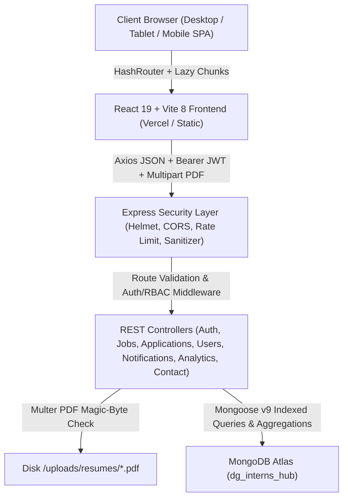
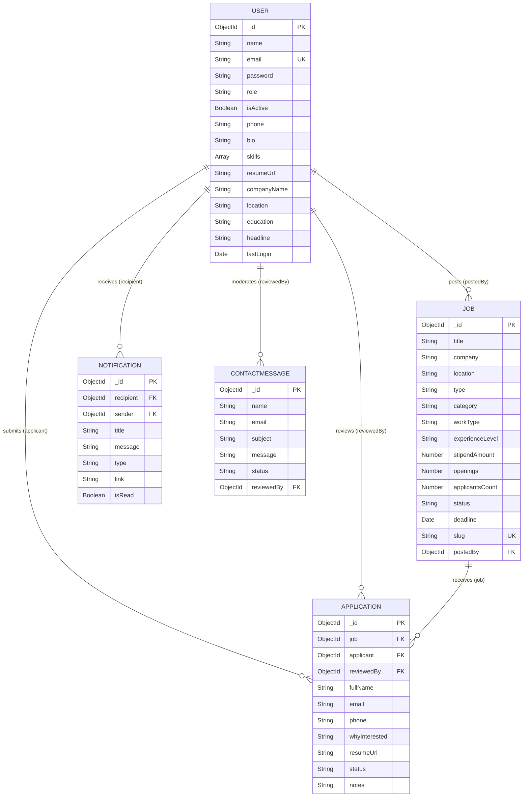
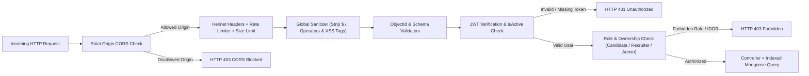

# DG Interns Hub (Week 12 Capstone) — Architecture & Entity-Relationship Diagrams

## 1. High-Level Full-Stack System Architecture

The Week 12 platform uses a decoupled **React 19 + Vite 8** SPA frontend communicating over HTTPS/REST JSON with a **Node.js + Express 5** API backend persisted to **MongoDB Atlas**.

---

## 2. Database Entity-Relationship Diagram (ER Diagram)

---

## 3. Request Security & Authorization Flow

